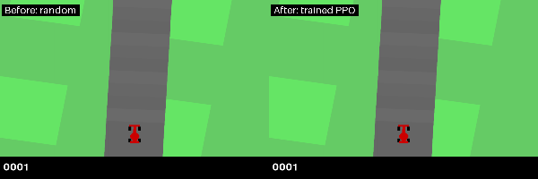
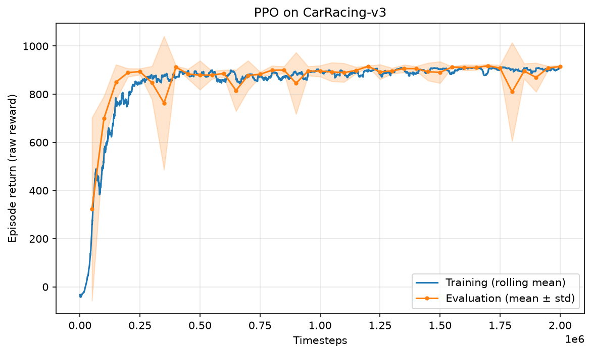

# Kurve

A reinforcement learning agent that learns to drive: first in Gymnasium's
`CarRacing-v3`, then in the Assetto Corsa racing simulator.

The project is built in three stages, each changing one thing at a time:

| Stage | Algorithm | Environment | Status |
|---|---|---|---|
| 1 | PPO (discrete actions) | CarRacing-v3 | Done: 917.0 ± 9.6 mean return, up from -43.0 for a random policy |
| 2 | SAC (continuous actions) | CarRacing-v3 | Not started |
| 3 | SAC | Assetto Corsa | Not started |

Stage 2 isolates the algorithm change, Stage 3 isolates the environment
change. Every stage ends with a before/after comparison: a random policy
against the trained agent, on the same tracks, as video and as numbers.

## Setup

See [docs/SETUP.md](docs/SETUP.md). In short: create a virtual environment,
install PyTorch with CUDA, get Box2D built, then
`pip install --find-links wheels -r requirements.txt`.

## Usage

Everything runs from the repo root and is driven by a config file.

```bash
# 1. Record the untrained baseline (random actions)
python -m src.utils.compare --config config/ppo_carracing.yaml --stage before

# 2. Train. Evaluates every 50k timesteps, records a video every 400k and at the end.
python -m src.train --config config/ppo_carracing.yaml

# 3. Watch training progress
tensorboard --logdir logs/ppo_carracing/tensorboard

# 4. Score the trained agent (final_model.zip) and build the comparison
python -m src.utils.compare --config config/ppo_carracing.yaml --stage after

# 5. Plot the learning curve
python -m src.utils.plotting --config config/ppo_carracing.yaml

# Watch the agent drive live (add --random for the untrained baseline)
python -m src.evaluate --config config/ppo_carracing.yaml
```

`python -m src.train --config config/ppo_carracing.yaml --smoke` runs the whole
pipeline for 1,024 timesteps as a quick check.

Where things end up, per run:

| Path | Contents |
|---|---|
| `models/<run>/` | `best_model.zip`, `final_model.zip`, `checkpoints/` |
| `logs/<run>/` | TensorBoard logs, per-env episode CSVs, `evaluations.npz` |
| `videos/<run>/` | `step_0_random.mp4`, `step_<n>.mp4` (every 400k timesteps), `step_final.mp4`, `comparison_side_by_side.mp4` |
| `results/<run>/` | `metrics_before.json`, `metrics_after.json`, `comparison_table.md`, `learning_curve.png` |

## Stage 1: PPO on CarRacing-v3

The agent sees raw 96x96 RGB pixels and picks one of five actions (nothing,
steer right, steer left, gas, brake). Settings live in
[config/ppo_carracing.yaml](config/ppo_carracing.yaml).

- **Observation pipeline:** the opening camera zoom is skipped, each action is
  held for 2 frames, and the last 4 frames are stacked so the CNN can infer
  speed and turning.
- **Reward shaping (training only):** per-step reward is capped at 1.0, and an
  episode ends early after 100 steps without reaching a new track tile.
  Evaluation and all reported numbers use the unmodified CarRacing reward.
- **Training:** 8 parallel environments, `CnnPolicy`, 2M timesteps. On an RTX
  5070 Laptop GPU the full run took 3 hours 4 minutes (about 180 timesteps per
  second averaged over the run, evaluations and videos included).

### Results



Random policy against the trained agent (`final_model.zip`, the weights at the
end of training), 10 episodes each on the same 10 tracks, scored with the
unmodified reward. CarRacing counts as solved at an average of 900.

| Metric | Before (random) | After (trained PPO) |
|---|---|---|
| Mean return | -43.0 ± 11.6 | **917.0 ± 9.6** |
| Min / max return | -66.6 / -29.3 | 894.6 / 928.5 |
| Episodes scoring 900+ | 0 / 10 | 9 / 10 |
| Laps completed | 0 / 10 | 9 / 10 |
| Mean track completion | 5.9% | 100.0% |
| Mean lap time | n/a | 14.6 s |
| Mean speed (simulator units) | 2.8 | 63.5 |
| Time with all wheels off the road | 5.3% | 0.0% |
| Share of steps on the gas | 19.6% | 74.9% |

On the one track it did not finish (seed 10048) the agent reached 287 of 288
tiles but ran out of time before closing the lap, scoring 894.6.

The full report, with every metric, action usage and a per-track breakdown, is
in [results/ppo_carracing/comparison_table.md](results/ppo_carracing/comparison_table.md);
the raw numbers are in `metrics_before.json` and `metrics_after.json` next to
it. The side-by-side video is
[videos/ppo_carracing/comparison_side_by_side.mp4](videos/ppo_carracing/comparison_side_by_side.mp4).



Scores during training, on 5 fixed tracks (the first 5 of the 10 above):

| Timesteps | Mean return |
|---|---|
| 50k | 323.0 ± 380.2 |
| 200k | 889.9 ± 17.0 |
| 400k | 912.6 ± 5.2 |
| 1.7M (best, saved as `best_model.zip`) | 918.2 ± 6.0 |
| 2M (end of training) | **914.8 ± 5.1** |

The scores were not monotonic: a few evaluations dipped (for example
809.8 ± 204.8 at 1.8M) before recovering. The videos in
[videos/ppo_carracing/](videos/ppo_carracing/) show the same track at 0, 400k,
800k, 1.2M, 1.6M timesteps and at the end of training.

`best_model.zip` scores 918.9 ± 6.5 on the same 10 tracks, which is within
noise of the final model. The comparison uses the final model because the
best one was selected by its score on 5 of those tracks.

## Tests

```bash
python -m pytest -q
```

## License

[MIT](LICENSE)
